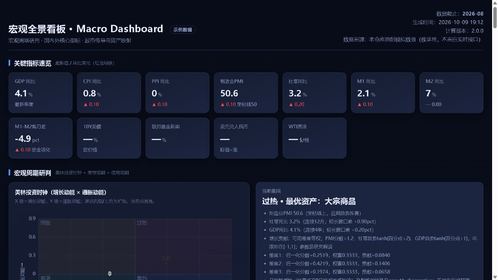

# 宏观研究看板

观察增长、物价、货币和信贷变化，并对照行业价格、产能、开工率与库存证据。

[原创代码 MIT](LICENSE) · [发行说明](https://github.com/KILING-TASI/macro-dashboard-engine/releases/tag/v1.7.9) · [运行检查](https://github.com/KILING-TASI/macro-dashboard-engine/actions) · [English](README.en.md)

当前发布：**v1.7.9 · 普通发行版**。Python **3.10+**；基础功能只需 Python，无第三方运行依赖。

[快速开始](#快速开始) · [使用自己的资料](#使用自己的资料) · [能力与边界](#能力与边界) · [文档与维护](#文档与维护)

## 能解决什么问题

**增长、物价和信贷有哪些变化？行业四类证据齐了吗？**

独立维护宏观和行业指标解释；新增数据采集与资料储备归数据仓，ETF可以消费已核特征。

| 需要准备 | 会得到什么 |
|---|---|
| 指标序列、发布日期与统计口径；行业判断还需对应证据。 | 增长、物价、货币与信贷变化对照，以及行业证据和覆盖缺口。 |

## 快速开始

1. 安装 Python 3.10 或以上版本。
2. 下载[完整源码 ZIP](https://github.com/KILING-TASI/macro-dashboard-engine/releases/download/v1.7.9/macro-dashboard-engine-v1.7.9-source.zip)并解压，进入包含 `try_demo.py` 的目录。
3. 在该目录打开终端，运行：

```console
python try_demo.py --no-open --out-dir reports/first-demo
```

按终端给出的路径打开 HTML。也可以在源码目录双击 `Start-Demo.cmd`（Windows），或运行 `sh Start-Demo.sh`（Linux/macOS）。教学使用原创模拟资料，不自动取得真实数据。

使用 Git 时，先运行 `git clone https://github.com/KILING-TASI/macro-dashboard-engine.git`，再运行 `cd macro-dashboard-engine`，随后执行上面的教学命令。重复运行请指定新目录，历史结果会保留。



截图对应历史教学样本，具体日期、参数和缺口以该报告为准。

## 使用自己的资料

先按[资料准备与排错](BEGINNER.md)整理来源、日期、单位和必要字段，再按[使用说明](USAGE.md)选择对应入口。以下两种使用方式分别配置。

**命令行（CLI）**：在源码目录安装本仓，然后查看可用命令：

```console
python -m pip install .
macro-dashboard-engine --help
```

基础安装不需要科学计算或 PDF 组件。安装时下载构建工具或可选依赖可能需要联网。

**助手 Skill**：按 [SKILL.md](SKILL.md) 配置，保留完整目录及其引用资源。安装 CLI 不会自动注册 Skill，也不表示已在第三方技能市场上架。

| 身份 | 名称 |
|---|---|
| GitHub 仓库 / Python 发行包 | `macro-dashboard-engine` |
| 主要命令 | `macro-dashboard-engine` |
| SKILL.md 中的名称 | `macro-dashboard` |

本仓可单独使用。需要跨工具功能时，再按说明安装并明确配置对应工具的位置。

## 能力与边界

同期表现不直接解释为因果；行业证据不自动合成为盈利预测，尚未取得全部31行业真实数据。

报告中的来源、日期、假设和未知事项需一起阅读。程序运行成功不等于来源已经认证、资料完整或投资判断有效。原创代码采用MIT，第三方代码、公告、研报和数据仍按各自权利范围处理。

## 文档与维护

- [详细命令与方法](USAGE.md)
- [资料准备与排错](BEGINNER.md)
- [Skill 调用指引](SKILL.md)
- [版本记录](CHANGELOG.md)
- [许可与第三方范围](THIRD_PARTY_NOTICES.md)
- [问题与证据复查](QUESTION_REVIEW.md)
- [审计范围](AUDIT_SCOPE.md)

[贡献说明](CONTRIBUTING.md) · [安全反馈](SECURITY.md) · [更新与清理](LIFECYCLE.md)

[按问题选择其他工具](https://github.com/KILING-TASI/research-workbench/blob/main/references/tool-navigation.md)；资料契约校验已并入[数据仓](https://github.com/KILING-TASI/cn-data-adapters/blob/main/CONTRACT_MIGRATION.md)。默认分支的文档整理不改写已发布的源码包和历史结果；版本变化见 [CHANGELOG.md](CHANGELOG.md)。

## 公开底稿验收

[覆盖登记](PUBLIC_VALIDATION.json)区分公开事实、混合教学与尚缺样本。运行 `python tools/verify_public_validation.py --run-checks --output reports/public-validation-v1.json` 可核对冻结文本与已登记反例；重复运行使用新文件。通过不表示重新认证原文或真实市场效果，未取得的样本仍列为缺口。
